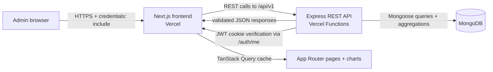
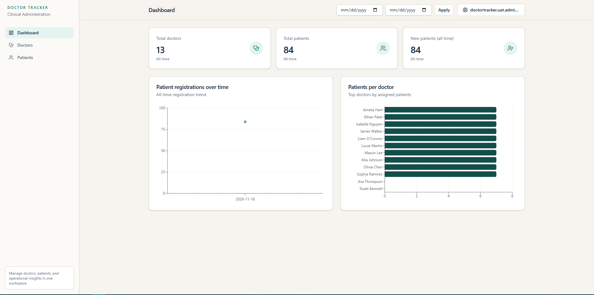
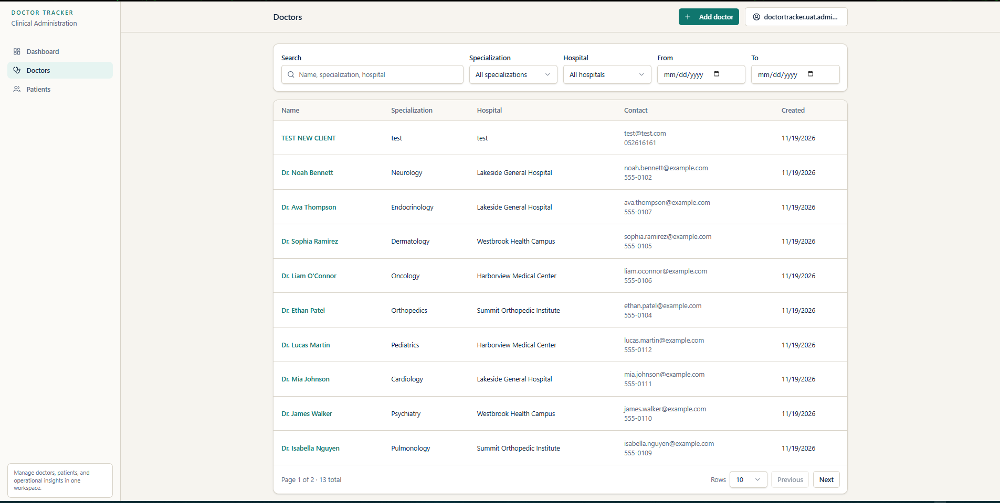
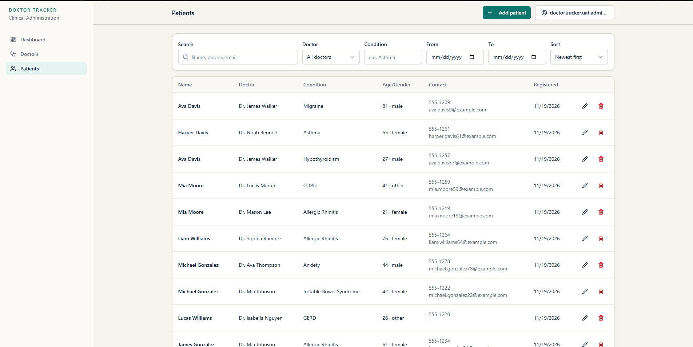

# Doctor Tracker

Doctor Tracker is a clinical administration workspace for maintaining a doctor directory, managing the patients assigned to each doctor, and reviewing operational statistics. A Next.js frontend talks to an isolated Express REST API backed by MongoDB, with admin-only authentication and server-side search, filtering, pagination, and analytics.

## Live application links

| Resource | URL |
| --- | --- |
| Live frontend | https://web-sage-six-90.vercel.app |
| Live backend API | https://api-teal-chi-18.vercel.app/api/v1 |
| API health (liveness) | https://api-teal-chi-18.vercel.app/api/v1/health |
| API readiness (database ping) | https://api-teal-chi-18.vercel.app/api/v1/ready |

## Source repositories

This project is a monorepo; the frontend and backend are deployed separately from the same repository.

- Repository: https://github.com/mohammad-fahad/doctor_task_tracker_plan
- Frontend source: [`apps/web`](https://github.com/mohammad-fahad/doctor_task_tracker_plan/tree/main/apps/web)
- Backend source: [`apps/api`](https://github.com/mohammad-fahad/doctor_task_tracker_plan/tree/main/apps/api)

```text
doctor-tracker/
├── apps/
│   ├── api/   # Express REST API, Mongoose models, Vercel function entry
│   └── web/   # Next.js App Router frontend
├── docs/      # Deployment, security, CI/CD, decision records, screenshots
└── README.md
```

## Features

### Authentication
- Admin sign-in with bcrypt-hashed passwords and a JWT stored in an HTTP-only cookie
- No public registration; the only user role is `admin`
- Protected API routes and a frontend session gate backed by `GET /auth/me`
- Logout clears the auth cookie and invalidates cached client state
- Login rate limiting, credentialed CORS allowlist, and origin checks for state-changing browser requests

### Doctors
- Create a doctor with name, specialization, hospital, phone, and email
- List doctors with server-side pagination, sorting, and debounced search across name, specialization, and hospital
- Filter by specialization, hospital, and creation-date range
- Open a doctor detail page showing profile data, patient count, and assigned patients
- Add a patient directly under a doctor and remove a patient from a doctor's list

Doctor update and delete are intentionally not implemented because they are not part of the assignment specification.

### Patients
- Dedicated patient page with create, edit, delete, and confirmation dialogs
- Server-side pagination, sorting, and debounced search across name, phone, and email
- Filter by doctor, condition, and creation-date range
- Assign or reassign a doctor when creating or editing a patient

### Dashboard
- All-time totals for doctors and patients
- New-patient count for the selected date range
- Patient registrations-over-time area chart
- Patients-per-doctor bar chart
- Loading, empty, and error states

## Technology stack

| Layer | Technologies |
| --- | --- |
| Frontend (`apps/web`) | Next.js 16 App Router, React 19, TypeScript, Tailwind CSS 4, Radix UI primitives, TanStack Query, React Hook Form, Zod, Recharts, Lucide, Sonner |
| Backend (`apps/api`) | Node.js, Express 5, TypeScript, MongoDB with Mongoose 9, Zod, bcryptjs, jsonwebtoken, Helmet, CORS, cookie-parser, express-rate-limit |
| Testing | Vitest, Supertest; CI provides MongoDB 7 for integration tests |
| Deployment | Vercel (Next.js app and Express function), MongoDB Atlas |

## Local setup guide

### Prerequisites

- Node.js 22+ (CI uses Node 24) and npm 10+
- A local MongoDB instance or an isolated development database
- No production database, production credentials, or live Vercel settings are required for local setup

### Install and configure

```bash
npm install
cp apps/api/.env.example apps/api/.env
cp apps/web/.env.example apps/web/.env
```

`apps/api/.env` (placeholder values only):

```env
NODE_ENV=development
PORT=4000
MONGODB_URI=mongodb://localhost:27017/doctor_tracker
JWT_SECRET=replace-with-strong-secret-at-least-16-chars
JWT_EXPIRES_IN=7d
COOKIE_NAME=dt_token
COOKIE_SECURE=false
COOKIE_SAME_SITE=lax
COOKIE_DOMAIN=
CORS_ORIGINS=http://localhost:3000
ADMIN_EMAIL=admin@example.com
ADMIN_PASSWORD=replace-with-a-strong-unique-password
MONGODB_URI_TEST=mongodb://localhost:27017/doctor_tracker_test
```

`apps/web/.env`:

```env
NEXT_PUBLIC_API_BASE_URL=http://localhost:4000/api/v1
COOKIE_NAME=dt_token
```

The maintained placeholder templates are [`.env.example`](.env.example), [`apps/api/.env.example`](apps/api/.env.example), and [`apps/web/.env.example`](apps/web/.env.example). Never commit `.env` files or real secrets.

### Seed and run

```bash
npm run seed:uat
npm run dev
```

Open http://localhost:3000/login and sign in with the `ADMIN_EMAIL` and `ADMIN_PASSWORD` configured in `apps/api/.env`.

Useful variants:

```bash
npm run dev:api          # API only: http://localhost:4000/api/v1
npm run dev:web          # Frontend only: http://localhost:3000
npm run seed:uat -- --admin-only
npm run seed:uat -- --demo-only
npm run seed:uat -- --help
```

`seed:uat` creates the configured admin if missing and upserts 12 fictional doctors and 84 fictional patients with deterministic IDs. It is idempotent and does not overwrite an existing admin password unless an explicit reset is requested. See the [deployment guide](docs/deployment.md) for owner-only production bootstrap procedures.

### Demo access

No demo credentials are committed and no dedicated public demo identity is provisioned in this repository. Before public demo access is advertised, the owner must provision a separate demo admin with a unique password and an isolated dataset containing only fictional records. Do not publish or reuse production administrator credentials.

## System architecture



The browser never reads the auth cookie from JavaScript. Login is a credentialed cross-origin request to the API; the API sets an HTTP-only JWT cookie with `Secure`, `SameSite`, and optional domain settings controlled by environment variables. Protected pages call `GET /auth/me`, the API verifies the cookie and user on every request, and unauthenticated visitors are redirected to `/login?next=...`. The Next.js proxy only redirects an already cookie-bearing visitor away from `/login`; it is not the authorization gate. API readiness (`/ready`) performs a real database ping, while health (`/health`) remains a liveness check.

## Two technical decisions

### 1. Separate Next.js frontend and Express REST API

The UI is a Next.js App Router application and all domain logic lives behind a versioned Express API. This keeps rendering and client state concerns separate from persistence, validation, and authorization, lets each deployable be promoted independently on Vercel, and gives non-browser clients the same REST contract.

The trade-off is cross-origin configuration: credentialed CORS, exact origin allowlists, and `SameSite=None; Secure` cookies must agree across both projects. The code handles this explicitly with shared cookie-name configuration, API-side session verification, and build-time validation of the frontend API base URL.

### 2. Server-side filtering, pagination, indexes, and aggregation

Doctor and patient lists are filtered, sorted, counted, and paginated in MongoDB using allowlisted page sizes (10/20/50), stable sorts, `.lean()` reads, and selective population. Dashboard metrics use aggregation pipelines and counters instead of transferring collections to the client.

The trade-off is that query shapes and indexes must be maintained together. Normalized fields support exact specialization, hospital, and condition filters; date ranges use `createdAt`; and compound indexes cover common doctor and patient sort/filter combinations. Free-text search keeps escaped case-insensitive substring behavior, which is more flexible than strict prefix search but is not as index-selective; server-side limits keep its cost bounded.

## Performance and security

- **Indexes:** doctors have indexes on normalized name, specialization, and hospital values, `createdAt`, and a compound specialization/hospital/date index. Patients have indexes on `doctorId + createdAt`, `conditionNormalized + createdAt`, normalized name/phone/email, and `createdAt`. Users have a unique email index.
- **Queries:** filtered counts and page data run in parallel; reads use `.lean()`; doctor/patient relationship data is populated only where needed; analytics use `$match`, `$group`, `$lookup`, and `$dateToString` pipelines.
- **Frontend:** search and condition inputs are debounced, query parameters are memoized, TanStack Query caches and invalidates results, and chart/stat data is memoized.
- **Validation:** Zod schemas validate bodies, query strings, params, and ObjectIds at the API boundary; the frontend uses matching form validation and shows inline/field-level errors.
- **Authentication:** bcrypt password hashing, signed JWTs in HTTP-only cookies, API-side verification of every protected request, no public registration, and explicit logout.
- **Transport and headers:** credentialed CORS allowlist, origin verification for browser writes, Helmet security headers, and configurable secure cookie attributes for cross-site deployments.
- **Error handling:** centralized Express error handling, typed `ApiError`, status-aware client errors, and production-safe responses without stack traces.

## Visual evidence

Captures from local runs using fictional demo data; no production records are shown.

| Screen | Desktop | Mobile |
| --- | --- | --- |
| Dashboard | [View](docs/screenshots/dashboard_desktop.png) | [View](docs/screenshots/dashboard_mobile.png) |
| Doctors | [View](docs/screenshots/doctors_desktop.png) | [View](docs/screenshots/doctors_mobile.png) |
| Doctor detail | [View](docs/screenshots/doctors_detail.png) | — |
| Patients | [View](docs/screenshots/patient_desktop.png) | [View](docs/screenshots/patient_mobile.png) |

<details>
<summary>Dashboard (desktop)</summary>



</details>

<details>
<summary>Doctors list (desktop)</summary>



</details>

<details>
<summary>Patients list (desktop)</summary>



</details>

## API overview

Base URL: `https://api-teal-chi-18.vercel.app/api/v1`

All `/auth/me`, `/doctors`, `/patients`, and `/dashboard` routes require the auth cookie. Responses use `{ "success": true, "data": ... }`, with `pagination` alongside `data` for list endpoints.

| Method | Endpoint | Purpose |
| --- | --- | --- |
| `POST` | `/auth/login` | Sign in and set the HTTP-only cookie |
| `POST` | `/auth/logout` | Clear the auth cookie |
| `GET` | `/auth/me` | Return the current admin |
| `GET` | `/health` | Liveness check |
| `GET` | `/ready` | Readiness check with database ping |
| `GET` | `/doctors` | Paginated doctor list; `page`, `limit`, `search`, `specialization`, `hospital`, `from`, `to`, `sort` |
| `POST` | `/doctors` | Create a doctor |
| `GET` | `/doctors/filters/options` | Specialization and hospital filter values |
| `GET` | `/doctors/:id` | Doctor detail and patient count |
| `GET` | `/doctors/:id/patients` | Paginated patients for one doctor |
| `POST` | `/doctors/:id/patients` | Add a patient under a doctor |
| `GET` | `/patients` | Paginated patient list; `page`, `limit`, `search`, `doctorId`, `condition`, `from`, `to`, `sort` |
| `POST` | `/patients` | Create a patient |
| `GET` | `/patients/:id` | Patient detail |
| `PATCH` | `/patients/:id` | Update a patient |
| `DELETE` | `/patients/:id` | Delete a patient |
| `GET` | `/dashboard/summary` | Totals, period metrics, and chart data |

Example paginated response:

```json
{
  "success": true,
  "data": [],
  "pagination": { "page": 1, "limit": 10, "total": 0, "totalPages": 1 }
}
```

## Testing and verification

Local verification was run on Node.js 22.23.4 and npm 11.21.2.

```bash
npm run lint
npm run typecheck
npm run test:unit
MONGODB_URI_TEST= npm run test:integration
npm run build:api
npm run build:web
npm run audit:prod
git diff --check
```

| Check | Result |
| --- | --- |
| `npm run lint` | Passed |
| `npm run typecheck` | Passed |
| `npm run test:unit` | Passed: 7 API files / 46 tests, 5 web files / 18 tests |
| `MONGODB_URI_TEST= npm run test:integration` | Skipped locally: 4 files / 23 tests (no isolated MongoDB available); CI provides `mongo:7` |
| `npm run build:api` | Passed |
| `npm run build:web` | Passed |
| `npm run audit:prod` | Passed with 0 production vulnerabilities |
| `git diff --check` | Passed |

Live endpoint verification:

- Frontend: `200`, redirects `/` to `/dashboard`; `/login` returns `200`
- Health: `200` with `{"status":"ok"}`
- Readiness: `200` with `{"status":"ready","database":"connected"}`
- Protected API example: `GET /doctors` returns `401` without a cookie

Additional process notes are in [deployment](docs/deployment.md), [CI/CD](docs/ci-cd.md), [security audit](docs/security-audit.md), and [decision records](docs/decision-records.md).
